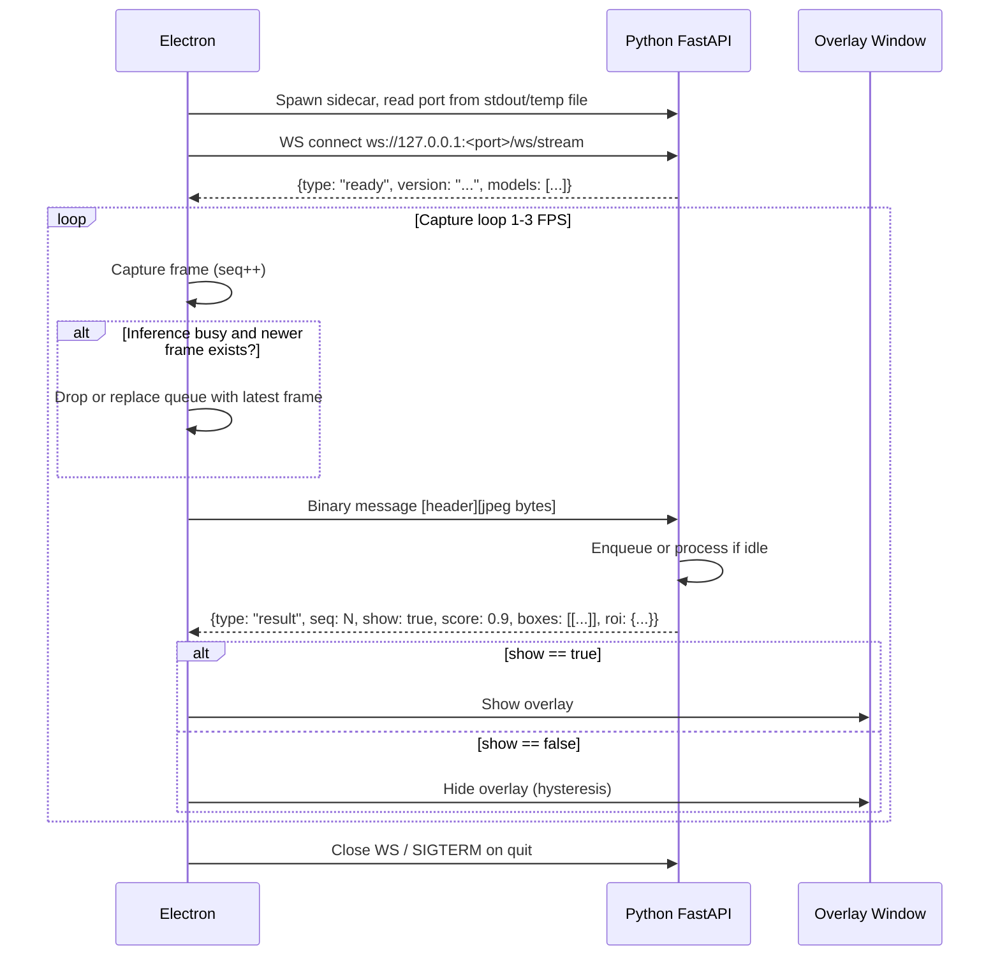

# RFC: ScreenBlur - Electron UI + Python FastAPI Sidecar (WebSocket Focus)

*Author*: Moneshwar  
*Status*: Draft  
*Target Platform*: macOS, Windows, Linux  
*Last Updated*: 2026-10-27

## 1. Summary

ScreenBlur is a cross-platform desktop app that detects explicit/adult scenes on screen and overlays a SFW GIF/blur over them. 

The approach is split:
- **Electron** - UI, system tray, global hotkeys, screen capture (`desktopCapturer`), overlay windows, permissions, and managing the sidecar binary.
- **Python FastAPI Sidecar** - Local inference service that runs models (e PR Title: RFC: ScreenBlur - Electron UI + Python FastAPI Sidecar (WebSocket Focus)

*Author*: Moneshwar  
*Status*: Draft  
*Target Platform*: macOS, Windows, Linux  
*Last Updated*: 2026-10-27

## 1. Summary

ScreenBlur is a cross-platform desktop app that detects explicit/adult scenes on screen and overlays a SFW GIF/blur over them.

The approach is split:
- **Electron** - UI, system tray, global hotkeys, screen capture (`desktopCapturer`), overlay windows, permissions, and managing the sidecar binary.
- **Python FastAPI Sidecar** - Local inference service that runs models (e.g. NudeNet/OpenNSFW) and decides when to show/hide overlays. Packaged as a standalone executable.

All processing stays local on `127.0.0.1`. No frames leave the device.

## 2. Goals & Non-Goals

### Goals
- [ ] Cross-platform (macOS, Windows, Linux)
- [ ] Keep screen capture + permissions in Electron
- [ ] Run all ML inference in a local Python FastAPI service over WebSocket
- [ ] Electron downloads/runs the correct sidecar binary per platform/arch
- [ ] Low latency frame transfer (avoid HTTP handshake per frame)
- [ ] Support frame dropping / cancellation when screen changes faster than inference
- [ ] Render a click-through transparent overlay on detection
- [ ] Debounce/hysteresis to prevent flicker
- [ ] Work offline after initial setup

### Non-Goals
- [ ] Cloud inference/telemetry
- [ ] Audio detection
- [ ] Blocking screenshots/recordings
- [ ] Mobile
- [ ] Full in-house model training

## 3. Why WebSocket

| Reason | Explanation |
| :-- | :-- |
| **Persistent connection** | No TCP + HTTP handshake per frame. After initial upgrade, we keep one long-lived connection over `ws://127.0.0.1`. |
| **Lower overhead** | Binary frames can be sent directly without JSON base64 wrapping. Less serialization/deserialization overhead. |
| **Full duplex** | Python can push control messages to Electron (pause/resume, reload model, change threshold) instantly without new requests. |
| **Frame cancellation / dropping** | If the model is still processing frame `t`, and Electron already captured frame `t+1` (due to motion/cuts), we can drop `t` or mark `t+1` as "latest" so we only process the most recent frame. HTTP makes this awkward without extra complexity; WS lets us just not wait or send a `cancel` intent. |
| **Efficient encoding** | We can use raw JPEG/encoded frames with small binary headers (e.g. `type + seq + display_id + ts`) to avoid re-encoding/extra copies. |
| **Backpressure control** | Track in-flight requests by sequence number. Only keep the newest unprocessed frame in queue to minimize perceived latency. |

## 4. Architecture

```mermaid
graph TD
    A[Electron Main] -->|spawn| B[Python FastAPI Sidecar]
    A -->|desktopCapturer + getUserMedia| C[Frame Capture]
    C -->|WS binary frame (JPEG + header)| B
    B -->|Worker Pool / asyncio| D[Preprocessor + Inference]
    D -->|WS JSON/binary result| A
    A -->|OverlayManager| E[Transparent Overlay BrowserWindow]
    A -->|Tray/Hotkeys/Settings| F[Electron UI]
```



## 5. WebSocket Protocol

### Connection
- Endpoint: `ws://127.0.0.1:<port>/ws/stream`
- Only accept connections from localhost
- Sidecar prints the port on startup or writes to temp file for Electron to read

### Message Types (Electron -> Sidecar)

#### Binary Frame (Hot Path)
Send as binary WebSocket message. Structure:
```
| offset | size | description |
| --- | --- | --- |
| 0 | 1 | msg_type = 0x01 (frame) |
| 1 | 4 | seq (uint32, big endian) |
| 5 | 4 | display_id (uint32) |
| 9 | 8 | ts (uint64 ms) |
| 17 | 2 * N | optional meta (can expand) |
| 17 + 2*N | var | JPEG bytes |
```
- Keep header minimal to avoid extra copies.
- Use sequence numbers to correlate results and to know if a result is stale.
- Only send the *latest* frame if inference is backed up (see 6.2).

#### JSON Control (Cold Path)
```json
{ "type": "pause" }
{ "type": "resume" }
{ "type": "config", "sensitivity": 0.8, "fps": 2 }
{ "type": "reload_model", "model_id": "nsfw_v1" }
```

### Message Types (Sidecar -> Electron)

#### Result
```json
{
  "type": "result",
  "seq": 123,
  "show": true,
  "score": 0.91,
  "category": "explicit",
  "boxes": [[x1,y1,x2,y2]],
  "roi": { "x": 100, "y": 200, "w": 400, "h": 300 },
  "latency_ms": 42
}
```

#### Ready / Error / Status
```json
{ "type": "ready", "version": "0.1.0", "models": ["nsfw_v1"] }
{ "type": "error", "code": "MODEL_NOT_LOADED", "message": "..." }
{ "type": "ping" }
```

## 6. Key Optimizations

### 6.1 Efficient Encoding/Decoding
- **Send raw JPEG**: Encode frames as JPEG at capture time (quality configurable, e.g. 70-80) instead of PNG. Much smaller size.
- **Avoid base64**: Binary WebSocket messages allow direct byte transfer. Faster and less memory usage.
- **Downscale early**: Resize frame to a reasonable resolution (e.g. 720p max) or directly to model input logic. Don't send full 4K frames unnecessarily.
- **Header only metadata**: Put timestamps/seq/display in binary header rather than wrapping in JSON.
- **Fast decode on Python side**: Use `cv2.imdecode` or `imageio` with optimized decoders. Avoid unnecessary color conversions.

### 6.2 Frame Dropping & Cancellation
This is the biggest advantage of WS over HTTP for this use case.
- **Latest-only queue**: Electron keeps at most 1 pending frame to send (or replaces the pending frame with the newest captured frame if not sent yet). If inference is running, don't enqueue older frames.
- **Seq-based staleness**: Sidecar can track `last_seq_processed`. If it finishes a frame with `seq = 10` but has already received `seq = 15`, it should prefer processing `15` next or just drop results for stale seqs. Electron should ignore results where `seq < last_applied_seq` to avoid flicker/overlay lag.
- **Cooperative cancellation**: If a new frame arrives while preprocessing/inference is in progress, the sidecar can switch to the latest frame if the model/runtime allows. For ONNXRuntime it's a bit trickier, but at minimum we can skip post-processing/results for superseded frames and immediately process the newest one.
- **Throttle by readiness**: Only capture/send when WS is open and connected. If the connection drops, pause capture until reconnected.

### 6.2.1 Example Flow (Dropping)
1. Electron captures frame `seq=1` (motion starts), sends it. Inference starts on sidecar.
2. Before result comes back, screen cuts to a new scene -> Electron captures `seq=2`, sees inference busy, replaces pending with `seq=2` (or sends immediately if idle slot exists). 
3. Sidecar finishes `seq=1` late -> Electron sees `seq=1 < current_target` and ignores the result (doesn't change overlay based on stale frame).
4. Sidecar processes `seq=2` and returns a fresh result that reflects the current scene.

## 7. Sidecar Distribution

Same as before, but connection is WS:
1. **Build**: `PyInstaller` (`--onefile`) with quantized ONNX models bundled via `--add-data`.
2. **Release**: GitHub Releases artifacts `screenblur-engine-<os>-<arch>`.
3. **Download/Verify**: Electron downloads to `app.getPath('userData')/bin/` with SHA256 checksum.
4. **Port discovery**: Sidecar writes `PORT=<port>` to stdout on startup; Electron reads it via `spawn` stdout or writes JSON to temp file.
5. **Spawn & Connect**: Electron spawns sidecar, waits for port, connects WS, waits for `ready` message.
6. **Dev mode**: Connect to `ws://127.0.0.1:8000/ws/stream` via env var without spawning bundled binary.

## 8. Implementation Plan

| Phase | Tasks | Time |
| :-- | :-- | :--- |
| Phase 0: Spike | Test WS server in FastAPI, binary frame transfer, spawn sidecar + connect from Electron, transparent overlay | 1 day |
| Phase 1: Python Sidecar (WS) | FastAPI + `websockets`/Starlette WS, binary header parsing, frame queue with latest-only logic, load quantized ONNX, preprocessing, inference, result emission with seq | 1-2 days |
| Phase 2: Electron Scaffold | Tray, SidecarManager (spawn/health/check/kill), WS client with reconnect, config store, IPC | 1 day |
| Phase 3: Capture + Streaming | Throttled capture (1-3 FPS), JPEG encode, binary framing, send latest frame only, track seq | 1 day |
| Phase 4: Decision + Overlay | Staleness check, hysteresis (rolling window), create transparent click-through overlay, show/hide based on fresh results | 1 day |
| Phase 5: Optimization & Drop Logic | Implement frame dropping/cancellation, latency logging, backpressure, connection recovery | 0.5-1 day |
| Phase 6: Packaging & Test | PyInstaller builds, electron-builder, test macOS permissions, fullscreen, rapid scene changes, crash recovery | 1-2 days |

**Total**: ~6-8 days for minimal PoC.

## 9. Tech Stack

| Layer | Tech | Notes |
| :-- | :-- | :--- |
| UI/Desktop | [Electron](https://www.electronjs.org/) + TypeScript + Vite | Tray, overlay, WS client |
| Sidecar | [FastAPI](https://fastapi.tiangolo.com/) + [Uvicorn](https://www.uvicorn.org/) + [websockets](https://websockets.readthedocs.io/) | WS endpoint with binary support |
| ML | [ONNXRuntime](https://onnxruntime.ai/) | Fast, lightweight for packaged binary |
| Image | [OpenCV](https://opencv.org/) / [Pillow](https://python-pillow.org/) / [numpy](https://numpy.org/) | Decode, resize, preprocess |
| Async | `asyncio` + background tasks | Handle WS, inference queue, latest-only processing |
| Packaging | [PyInstaller](https://pyinstaller.org/) | Single executable |
| Distribution | [electron-builder](https://www.electron.build/) | App packaging |

## 10. Risks & Mitigations

| Risk | Impact | Likelihood | Mitigation |
| :--- | :--- | :--- | :--- |
| WS connection drops/reconnects | High | Medium | Auto-reconnect with exponential backoff, pause capture while disconnected, show status in tray |
| Frame queue buildup if sidecar stuck | High | Medium | Latest-only queue, drop pending frames, ignore stale results by seq. Monitor latency and restart sidecar if unresponsive. |
| Binary framing bugs (endian/size) | Medium | Medium | Unit test framing code, version the header, validate size before decode |
| Increased complexity vs HTTP | Medium | Medium | Keep protocol minimal (binary header + JPEG), JSON only for control/results. Document protocol clearly. |
| Latency from Python GIL/asyncio | Medium | Medium | Run inference in a thread pool (`loop.run_in_executor`) or separate process. Use ONNXRuntime which releases GIL where possible. |
| Antivirus false positives | High | Medium | Code signing/notarization, build reproducibly |
| Overlay over fullscreen/DRM | Medium | High | Highest always-on-top level, `visibleOnFullScreen` on macOS. Test extensively. |

## 11. Minimal First Commit Checklist

- [ ] **Python WS Server**: FastAPI app with `/ws/stream`, accept binary frames with header, decode JPEG, load quantized ONNX, run inference, return JSON result with `seq`
- [ ] **Latest-only + Stale Filter**: Track current seq, ignore results with `seq < last_applied`, keep only newest pending frame
- [ ] **Electron WS Client**: Connect after spawning sidecar, binary framing, track seq, handle `ready`/`result`/`error`
- [ ] **Capture**: `desktopCapturer` at 2 FPS, JPEG encode (70-80), send binary frame if no newer pending
- [ ] **Overlay**: Transparent click-through `BrowserWindow` with hysteresis (3/5), ignore stale results
- [ ] **Sidecar Manager**: Spawn, read port from stdout, connect WS, health/restart/kill
- [ ] **Packaging**: PyInstaller build, checksum download flow in Electron

## 12. Notes

- **Security**: Bind to `127.0.0.1` only. No external origin connections. Don't log frame bytes. 
- **Privacy**: All processing local. Frames in memory, discarded immediately after send/decode.
- **Ethics**: Personal use only. Be transparent about screen capture permissions. Follow local laws and platform ToS.
- **Keep it minimal**: Start with classifier-only model and full-screen overlay. Add ROI/NudeNet and more advanced cancellation later. The key win here is WS + latest-only dropping - that's worth the extra complexity over HTTP for this exact use case.