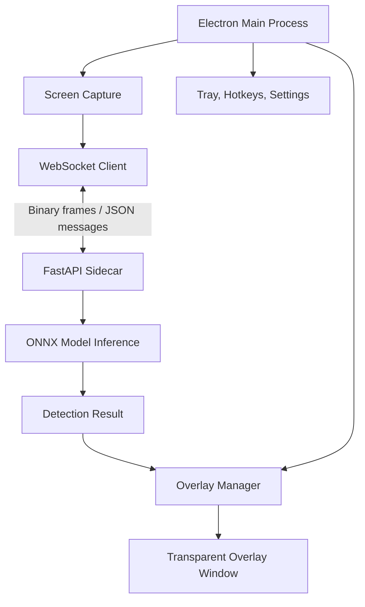
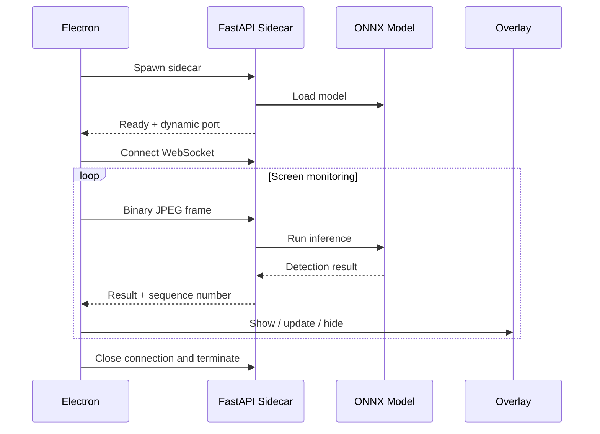

# RFC: ScreenBlur — Electron + FastAPI

**Author:** Moneshwar  
**Status:** Draft  
**Platforms:** macOS, Windows, Linux

## 1. Objective

Build a desktop application that detects explicit content on screen and displays a blur or SFW GIF overlay. All inference runs locally.

## 2. Architecture

### Component responsibilities

- **Electron:** Screen capture, JPEG encoding, UI, tray, hotkeys, overlay management, and sidecar lifecycle.
- **FastAPI:** WebSocket server, frame decoding, preprocessing, ONNX inference, and detection results.
- **Overlay:** Transparent, click-through window displaying a configurable blur or SFW GIF.

## 3. WebSocket Contract

**Endpoint:** `ws://127.0.0.1:<port>/ws/stream`

Electron sends:
- **Binary:** JPEG frame with a versioned header containing sequence number, display ID, timestamp, and payload length.
- **JSON:** `pause`, `resume`, and configuration updates.

Python returns:
- `ready`: Sidecar startup and model status.
- `result`: Sequence number, detection decision, confidence score, and inference latency.
- `error`: Error code and message.

Bind to loopback only, use a random per-launch authentication token, and validate incoming messages.

## 4. Processing Requirements

1. Capture and downscale frames in Electron; start at 1–3 FPS.
2. Send JPEG frames over a persistent WebSocket connection without Base64 encoding.
3. Allow one active inference and one replaceable pending frame.
4. Drop superseded frames and reject stale results using sequence numbers.
5. Show or hide the overlay using confidence thresholds and temporal hysteresis.
6. Handle disconnects, sidecar crashes, and screen-capture permission failures.
7. Keep all screen frames and inference processing local.

## 5. Sidecar Lifecycle

## 6. Technology Stack

| Layer | Technology |
|---|---|
| Desktop | Electron, TypeScript, Vite |
| Capture | Electron `desktopCapturer` |
| Backend | FastAPI, Uvicorn, WebSocket |
| Inference | ONNX Runtime |
| Image processing | OpenCV, NumPy |
| Packaging | PyInstaller, electron-builder |
| Distribution | GitHub Releases |

## 7. Implementation Checklist

- [ ] Implement FastAPI WebSocket server and binary protocol.
- [ ] Integrate ONNX model inference.
- [ ] Implement latest-only frame scheduling.
- [ ] Build Electron capture and WebSocket client.
- [ ] Implement overlay and stale-result filtering.
- [ ] Add sidecar startup, health monitoring, and shutdown.
- [ ] Package platform-specific binaries.
- [ ] Test permissions, multi-monitor behavior, fullscreen limitations, and crash recovery.

## 8. Non-Goals

Cloud inference, telemetry, audio detection, mobile support, and custom model training.

