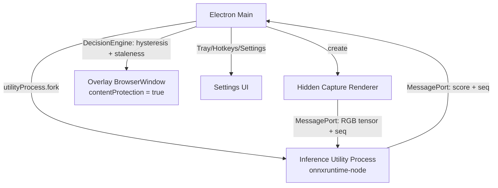
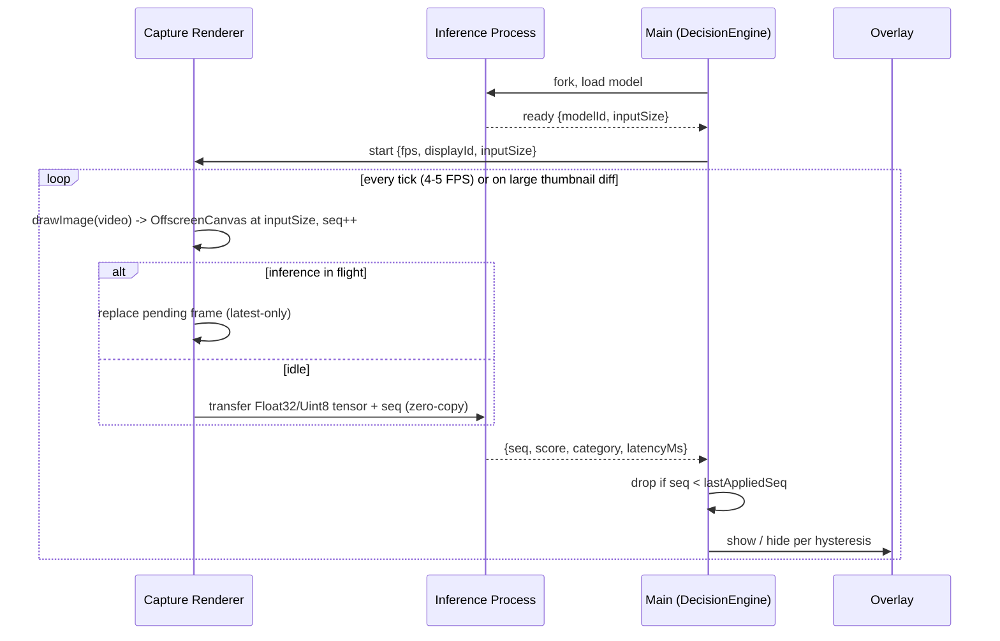

# RFC: ScreenBlur - Electron App with In-Process ONNX Inference

*Author*: Moneshwar  
*Status*: Draft (rev 2)  
*Target Platform*: Windows (v1), macOS (v1.1), Linux (later)  
*Last Updated*: 2026-10-27

## 1. Summary

ScreenBlur is a desktop app that detects explicit/adult scenes on screen and overlays a SFW GIF/blur over them.

Everything runs inside one Electron app:
- **Main process** - tray, global hotkeys, settings, permissions, overlay window management.
- **Capture renderer** (hidden window) - screen capture via `desktopCapturer` + `getUserMedia`, downscaling to model input size.
- **Inference utility process** (`utilityProcess`) - runs quantized ONNX models (e.g. OpenNSFW, later NudeNet) with `onnxruntime-node`, returns scores.
- **Overlay window** - transparent, click-through, always-on-top, **excluded from screen capture**.

All processing is local. No frames leave the device, and there is no network listener.

> **Change from rev 1:** The Python FastAPI sidecar over WebSocket has been replaced by in-process ONNX inference. The models are ONNX either way, and dropping Python removes PyInstaller, binary download/verification, sidecar lifecycle management, a custom wire protocol, and a localhost attack surface. The sidecar design is kept in [Appendix A](#appendix-a-python-sidecar-alternative) as a fallback.

## 2. Goals & Non-Goals

### Goals
- [ ] Windows first, then macOS; Linux best-effort later
- [ ] Overlay is never captured by our own screen capture (no self-feedback loop)
- [ ] Time from explicit content appearing to overlay shown: **target < 500 ms, max 1 s**
- [ ] Latest-frame-only pipeline: never process stale frames
- [ ] Asymmetric hysteresis: show fast, hide slow, no flicker
- [ ] Click-through transparent overlay over fullscreen apps
- [ ] Fully offline; models bundled with the app
- [ ] User controls for false positives (snooze, "this was wrong")

### Non-Goals
- [ ] Cloud inference/telemetry
- [ ] Audio detection
- [ ] Blocking screenshots/recordings
- [ ] Detecting DRM-protected video (it captures as black; see 10)
- [ ] Mobile
- [ ] Full in-house model training

## 3. Critical Problems This Design Must Solve

### 3.1 Overlay self-capture feedback loop
When the overlay is shown, the next captured frame contains the overlay instead of the content. The model returns "safe", the overlay hides, the content is re-detected, and the cycle repeats. Hysteresis only slows this flicker down.

**Mitigation:** exclude the overlay window from capture.

| Platform | Mechanism | Status |
| :-- | :-- | :-- |
| Windows 10 2004+ | `win.setContentProtection(true)` -> `WDA_EXCLUDEFROMCAPTURE` | Expected to work - verify in Phase 0 |
| macOS | `win.setContentProtection(true)` -> `NSWindowSharingNone` | Reportedly ignored by ScreenCaptureKit on recent macOS - **must verify in Phase 0** |
| Linux (X11/Wayland) | None reliable | Unsupported for v1 |

**Fallbacks if exclusion fails on a platform:**
1. Capture the specific window under the overlay (`desktopCapturer` window source) instead of the whole screen.
2. "Hold" mode: once shown, the overlay stays up for a minimum duration and is only re-evaluated using the fallback above, never using frames that include the overlay.

### 3.2 Exposure latency
At 2 FPS with a 3-of-5 hysteresis window, explicit content could be visible for 1.5-3 s before blurring. That is the core UX failure for this product.

**Mitigation:**
- Capture at **4-5 FPS** at model input resolution (224x224 / 320x320) - cheap enough to run continuously.
- **Adaptive rate:** compute a cheap diff on a tiny thumbnail (e.g. 32x32); on a large change (scene cut, scroll, new window), capture and infer immediately.
- **Asymmetric hysteresis** (see 6.3): show on a single positive frame.

## 4. Architecture





### Why this shape
- **Utility process for inference** keeps the main process and UI responsive, and isolates native-module crashes (Electron can restart it).
- **MessagePort with transferable buffers** gives zero-copy frame handoff. No JPEG encode/decode, no sockets, no ports, no auth.
- **Downscale in the renderer** with `OffscreenCanvas` / `drawImage` (GPU-accelerated). Send the tensor at exactly the model input size.

## 5. Internal Messages

All messages travel over `MessagePort`. No network sockets.

### Capture -> Inference
```ts
type FrameMsg = {
  type: "frame";
  seq: number;          // monotonically increasing
  displayId: number;
  ts: number;           // ms
  width: number;        // model input width
  height: number;       // model input height
  format: "rgb8" | "rgba8";
  data: ArrayBuffer;    // transferred, not copied
};
```

### Inference -> Main
```ts
type ResultMsg = {
  type: "result";
  seq: number;
  score: number;        // 0..1 explicit probability
  category: "safe" | "suggestive" | "explicit";
  boxes?: [number, number, number, number][]; // later, with NudeNet
  latencyMs: number;
};

type StatusMsg =
  | { type: "ready"; modelId: string; inputSize: [number, number] }
  | { type: "error"; code: "MODEL_NOT_LOADED" | "INFERENCE_FAILED"; message: string };
```

### Main -> Inference / Capture (control)
```ts
type ControlMsg =
  | { type: "pause" }
  | { type: "resume" }
  | { type: "config"; fps?: number; thresholdHigh?: number; thresholdLow?: number }
  | { type: "reload_model"; modelId: string };
```

## 6. Key Mechanics

### 6.1 Capture
- `desktopCapturer.getSources({ types: ["screen"] })` -> `getUserMedia` with `chromeMediaSourceId` in a hidden renderer.
- Each tick: `drawImage(video)` into an `OffscreenCanvas` sized to the model input, `getImageData`, transfer the buffer.
- Keep a 32x32 grayscale thumbnail of the previous frame; if mean absolute diff > threshold, trigger an immediate capture.
- Pause capture when the screen is locked or the display sleeps (`powerMonitor`).

### 6.2 Latest-only pipeline
- **At most one frame in flight, at most one pending.** A new frame replaces the pending one.
- **Staleness filter:** main tracks `lastAppliedSeq` and ignores any result with `seq < lastAppliedSeq`.
- **Cancellation:** ONNX runs can't be interrupted cheaply; we simply drop superseded results and immediately run the pending frame.

### 6.3 Asymmetric hysteresis (DecisionEngine)
| Transition | Rule (defaults, configurable) |
| :-- | :-- |
| Hidden -> Shown | **1** frame with `score >= thresholdHigh` (0.80) |
| Shown -> Hidden | **N = 4** consecutive frames with `score < thresholdLow` (0.50) **and** min show time 1.5 s elapsed |

Two thresholds (high/low) prevent oscillation around a single cutoff. Missing a detection is worse than a false positive here, so the show rule is aggressive.

### 6.4 Overlay
- Transparent `BrowserWindow`: `frame: false`, `transparent: true`, `focusable: false`, `skipTaskbar: true`.
- `setIgnoreMouseEvents(true)` for click-through.
- `setAlwaysOnTop(true, "screen-saver")`; on macOS `setVisibleOnAllWorkspaces(true, { visibleOnFullScreen: true })`.
- **`setContentProtection(true)`** - required (see 3.1).
- Pre-create one overlay per display at startup and toggle visibility (faster than creating on demand).
- v1 covers the full display. ROI/box overlays come later with NudeNet.

### 6.5 False-positive controls
- Tray + hotkey: **Snooze** (5 / 15 / 60 min).
- Hotkey on overlay: **"This was wrong"** - hides immediately and suppresses re-show for ~10 s.
- Sensitivity slider maps to `thresholdHigh` / `thresholdLow`.
- No frames are stored for feedback; only counts, locally.

## 7. Packaging & Distribution
1. Quantized ONNX models are bundled via electron-builder `extraResources`. No runtime download.
2. `onnxruntime-node` prebuilt binaries per platform/arch; unpack native modules from asar (`asarUnpack`).
3. Code signing on Windows and notarization on macOS from the first public build.
4. Model integrity: SHA256 of bundled models checked at load.

## 8. Implementation Plan

| Phase | Tasks | Time |
| :-- | :-- | :--- |
| **Phase 0: De-risk spike** | (a) Overlay with `setContentProtection(true)` - confirm it's absent from `desktopCapturer` frames on Windows **and** macOS. (b) `onnxruntime-node` inside `utilityProcess` runs OpenNSFW at < 50 ms. (c) End-to-end latency from content to overlay. | 1-2 days |
| Phase 1: Scaffold | Tray, settings store, hotkeys, utility process lifecycle (fork/restart/kill), MessagePort wiring | 1 day |
| Phase 2: Capture | Hidden renderer, `getUserMedia`, OffscreenCanvas downscale, thumbnail diff trigger, latest-only queue | 1 day |
| Phase 3: Inference | Model load, preprocessing (normalize/layout), run, result with seq, error handling | 1 day |
| Phase 4: Decision + Overlay | DecisionEngine (asymmetric hysteresis + staleness), per-display overlays, snooze / "wrong" controls | 1 day |
| Phase 5: Packaging & Test (Windows) | electron-builder, signing, fullscreen apps/games, multi-monitor, rapid scene changes, utility process crash recovery | 1-2 days |
| Phase 6: macOS | Screen Recording permission flow, content-protection verification/fallback, notarization | 1-2 days |

**Total**: ~5-7 days for a Windows PoC; +1-2 days for macOS.

**Go/no-go after Phase 0:** if overlay exclusion fails on a platform, that platform switches to the window-capture fallback (3.1) or is deferred.

## 9. Tech Stack

| Layer | Tech | Notes |
| :-- | :-- | :--- |
| Desktop | [Electron](https://www.electronjs.org/) + TypeScript + Vite | Main, capture renderer, overlay, settings |
| Inference | [onnxruntime-node](https://onnxruntime.ai/) in Electron `utilityProcess` | Quantized OpenNSFW (v1), NudeNet (later) |
| IPC | `MessageChannelMain` / `MessagePort` | Zero-copy transferable buffers |
| Image | `OffscreenCanvas` / Canvas 2D | Downscale + pixel extraction in the renderer |
| Packaging | [electron-builder](https://www.electron.build/) | Models in `extraResources` |

## 10. Risks & Mitigations

| Risk | Impact | Likelihood | Mitigation |
| :--- | :--- | :--- | :--- |
| Overlay captured by our own capture (feedback loop) | High | Medium (Win) / High (macOS) | `setContentProtection(true)`; verify in Phase 0; window-capture or hold-mode fallback |
| Exposure latency too high | High | Medium | 4-5 FPS at model resolution, diff-triggered capture, show on 1 frame |
| False positives (swimwear, skin, medical) | Medium | High | Two thresholds, snooze, "this was wrong", sensitivity slider |
| DRM video captures as black | Medium | High | Documented limitation - cannot be detected |
| `onnxruntime-node` native module packaging | Medium | Medium | `asarUnpack`, test per platform/arch in CI |
| Inference process crash/hang | Medium | Low | Electron restarts utility process; watchdog on result latency |
| CPU/battery usage | Medium | Medium | Small input size, quantized model, pause on idle/lock/battery saver |
| Overlay not on top of exclusive-fullscreen games | Medium | Medium | `screen-saver` level; document limitation |
| Linux/Wayland capture prompts every session | Medium | High | Linux out of scope for v1 |
| Antivirus false positives | Medium | Low | Code signing; no PyInstaller binary anymore |

## 11. Minimal First Commit Checklist

- [ ] **Phase 0 spike results recorded** (content protection on Win/macOS, inference latency, end-to-end latency)
- [ ] **Inference process**: `utilityProcess` loads quantized ONNX, accepts transferred tensors, returns `{seq, score}`
- [ ] **Capture**: hidden renderer at 4-5 FPS + diff trigger, downscale to input size, latest-only send
- [ ] **DecisionEngine**: staleness filter, show on 1 frame >= high, hide after 4 frames < low + min show time
- [ ] **Overlay**: per-display, transparent, click-through, `setContentProtection(true)`
- [ ] **Controls**: tray toggle, snooze, "this was wrong" hotkey
- [ ] **Packaging**: electron-builder Windows build with bundled model

## 12. Notes

- **Security**: No network listeners. All IPC is in-process via MessagePort.
- **Privacy**: Frames exist only in memory at model resolution and are discarded after inference. No frame logging.
- **Ethics**: Personal use only. Be transparent about screen capture permissions. Follow local laws and platform ToS.
- **Keep it minimal**: Classifier-only model and full-screen overlay first. ROI/NudeNet later.

---

## Appendix A: Python Sidecar Alternative

Use only if a required model or library cannot run under ONNX Runtime in Node. If adopted, apply these corrections to the rev 1 design:

- **Transport**: plain HTTP keep-alive is sufficient at these frame rates; WebSocket is optional. Latest-only dropping is a client-side rule (one in flight, replace pending, ignore stale seq) and works with either.
- **Authentication (required)**: any web page in the user's browser can connect to `127.0.0.1`. Generate a random token per launch, pass it via env var or stdin, require it on every request/connection, and reject unexpected `Origin` headers.
- **Port**: bind to `127.0.0.1:0`, print the chosen port to stdout.
- **Binary header** (if WS is used): add a version byte and an explicit meta-length field:

  | offset | size | field |
  | --- | --- | --- |
  | 0 | 1 | version (0x01) |
  | 1 | 1 | msg_type (0x01 = frame) |
  | 2 | 4 | seq (uint32 BE) |
  | 6 | 4 | display_id (uint32 BE) |
  | 10 | 8 | ts (uint64 BE, ms) |
  | 18 | 2 | meta_len (uint16 BE) |
  | 20 | meta_len | meta |
  | 20 + meta_len | var | pixel data (raw RGB at model input size preferred over JPEG) |

- **Distribution**: bundle the sidecar in `extraResources` instead of downloading at runtime. Expect antivirus false positives from PyInstaller `--onefile`; prefer `--onedir` and sign the binaries.
- **Inference**: run in `run_in_executor` or a separate process so the event loop stays responsive.
